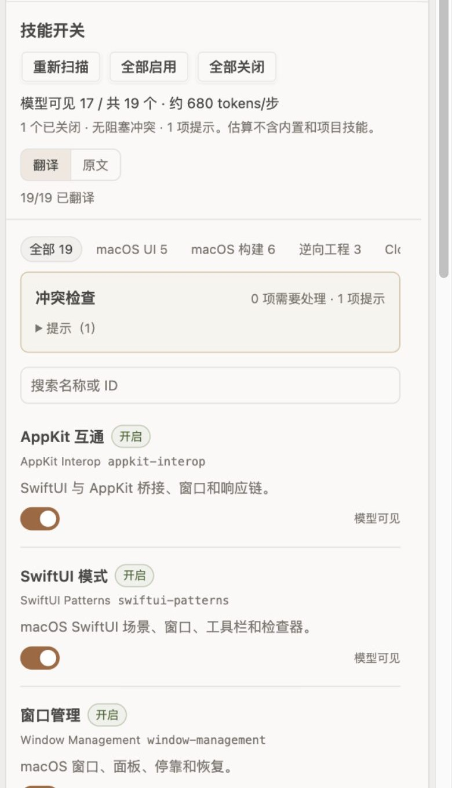

# openchamber-skills

English | [简体中文](#简体中文)

## English

**Skills Manager** enables or disables OpenCode global skills by renaming their entry files, without editing skill bodies. It also checks entry conflicts, translates names and descriptions to Chinese on demand, and offers editable groups for batch toggling.

### Highlights

- Toggle `SKILL.md` ↔ `SKILL.md.disabled` and flat `<id>.md` ↔ `<id>.md.disabled`.
- Conflict detection for duplicate entries, unreadable files and malformed frontmatter.
- Optional Chinese translation of names and descriptions using the host's small model; cached with `0600` permissions.
- Local service on `127.0.0.1` with Bearer-token checks; only manages `~/.config/opencode/skills`.
- Editable groups with local persistence for batch toggling; disabling the extension does not re-enable skills.
- Create, rename, delete and reset groups from the panel; configuration is stored at `~/.config/openchamber/skills-manager/groups.json` with `0600` permissions.

### Screenshot



*Synthetic preview with sample skills. No real skill files are read or changed.*

### Install

In OpenChamber, open **Settings → Extensions → Add extension** and paste:

```text
https://github.com/chenyuhao0628/openchamber-skills
```

Requires OpenChamber **2.4.0 or newer**. The `model` capability is used only for the optional translation action.

> Click **Enable all** before disabling or uninstalling the extension. The panel UI is currently Chinese. The full Chinese documentation is below.

---

## 简体中文

当前版本 **0.3.0**，核对日期 **2026-10-24**。只管理 OpenCode 全局技能目录 `~/.config/opencode/skills`：按入口文档启停、中文翻译、按可编辑的联动分组批量开关，并检查入口冲突。不改写技能正文，不新增技能，不碰其他 agent 的技能目录。

## 安装

从 GitHub 安装：在 OpenChamber **设置 → 扩展 → 添加扩展 → URL** 填入仓库地址，宿主会拉取已构建的 `panel/main.js` 和 `service/main.js`：

```text
https://github.com/chenyuhao0628/openchamber-skills
```

0.2.0 新增“模型调用”能力用于中文翻译；0.2.1 修正清单位置；0.3.0 增加可编辑分组并持久化到本地配置。更新或重装 0.3.0 时仍会出现模型调用权限提示。

从本地目录安装（开发时）：

```sh
npm ci
npm run typecheck
npm test
```

`npm test` 会先构建。然后在 **设置 → 扩展 → 添加扩展 → 文件夹** 选择本目录，允许本地服务运行。

服务由宿主启动，仅监听 `127.0.0.1`，每个请求都检查宿主 Bearer token。它只扫描和改名 `~/.config/opencode/skills`，不读凭据、不写 `opencode.json`、不发起外部网络请求。

## 开关方式

- 关闭：`SKILL.md` → `SKILL.md.disabled`；平铺技能 `<id>.md` → `<id>.md.disabled`
- 开启：改回原名

OpenCode 的扫描器只认名为 `SKILL.md` 的文件和源根目录的 `*.md`。改名后技能不会被注册：模型可用列表里没有，`skill` 工具也找不到。下一次扫描后生效；当前会话里已经加载过的正文不会撤回。

## 中文翻译

- 面板顶部只有 **“翻译”/“原文”** 两个按钮；没有单独的语言开关。
- 点“翻译”会把当前 19 个技能的**名称和描述**用宿主小模型译成简体中文；技能 ID、命令、路径和代码保持原样。
- 只翻译面板显示，不改 OpenCode 实际加载的英文描述；模型看到的仍是原文。
- 译文缓存到 `~/.config/openchamber/skills-manager/translations.json`（0600）。技能内容变化后 hash 不匹配，会显示原文并允许重新翻译。
- 默认只翻名称和描述，不翻完整 SKILL.md；按下“翻译”才会调用模型，分批进行并显示进度。
- 翻译失败保留原文并提示原因；不会阻塞技能开关。
- 需要“模型调用”能力；使用 OpenChamber 已配置的小模型，不新增 API Key。

## 联动分组

分组是面板元数据，不是技能，不增加模型上下文。首次读取使用六个预设组：

| 组 | 技能 |
| --- | --- |
| macOS UI | appkit-interop → swiftui-patterns → window-management → liquid-glass → view-refactor |
| macOS 构建 | build-run-debug → test-triage → swiftpm-macos → signing-entitlements → packaging-notarization → telemetry |
| 逆向工程 | reverse-engineering-unpacking → kuna-decompiler → reverse-engineer-anything |
| Cloudflare | cloudflare → workers-best-practices → wrangler |
| 视频 | yichen-jianying-edit |
| 浏览器 | browser-skill |

- 点组标签右侧的**编辑分组**可新建分组、改名、勾选成员、删除分组或恢复预设；成员顺序按勾选先后保存，并决定列表里的步骤号。
- 分组配置写入 `~/.config/openchamber/skills-manager/groups.json`（0600），支持最多 50 个分组、40 字符组名；组名不能重复，分组 ID 在改名时保持不变。
- 预设只在没有配置文件时作为初始值。修改、删除或新建后以 `groups.json` 为准；点“恢复预设”会用六个预设组覆盖当前配置，执行前就地确认。
- 保存后立即刷新组标签和筛选，不改技能文件，也不改变模型上下文。没有跨窗口锁，多个面板同时保存时最后一次写入生效。
- 顶部组标签显示可用技能数量；选中后列表只显示该组，并按顺序标注步骤号。
- **启用整组 / 关闭整组**只处理该组成员。
- **仅启用本组**会关闭其他组的文件技能，适合控制上下文；执行前就地确认。
- 组内有冲突或缺失技能时阻止组操作；缺失会明确显示，可在编辑器里单独移除。
- 分组只保证“这些技能一起可见”，不会强制模型按顺序使用；要强制工作流顺序需要额外规则/路由技能，会增加上下文，本版不做。
- `groups.json` 损坏或无法读取时，面板保留预设用于展示并禁止编辑；修复或备份文件后点“重新读取”，不会静默覆盖原文件。

## 面板

- 顶部：模型可见数量、总数、约 token 估算；翻译/原文按钮和翻译进度。
- 组标签：全部 + 自定义分组（首次为六个预设），右侧固定“编辑分组”入口。
- 组操作栏：启用整组、关闭整组、仅启用本组。
- 搜索框；技能行显示中文名称/描述或原文、ID、状态和开关。
- 有冲突时才显示冲突区；没有冲突不占版面。
- 全部启用/全部关闭需要就地确认。

## 冲突检查

| 类型 | 行为 |
| --- | --- |
| 同目录同时有 `SKILL.md` 和 `SKILL.md.disabled` | 阻塞；提供“保留启用”/“保留关闭”，另一个文件备份为 `.conflict-<时间>-<随机>` |
| 同 ID 有多个入口（平铺和目录重名） | 提示并显示生效入口；开关会处理所有同名入口 |
| frontmatter 未闭合 / 入口为空 | 提示；入口开关仍可用；OpenCode 可能跳过该技能 |
| 入口没有 `description` 或标记为仅手动调用 | 提示；模型不会自动选用 |
| 入口文件无法读取 | 提示；入口开关仍可用 |
| 技能目录无法读取 | 阻塞所有写操作，避免在状态不明时继续 |

“保留启用”会把旧的停用入口备份，保留当前启用入口；“保留关闭”会把旧停用入口备份，再用当前入口替换停用入口。两种情况都不直接删除用户文件。

## 范围

| 范围 | 是否处理 |
| --- | --- |
| `~/.config/opencode/skills` | 是 |
| `~/.claude/skills`、`~/.agents/skills` | 否，完全不读取 |
| 项目 `.opencode/skills` | 否 |
| `opencode.json` 里的自定义 `skills` 路径 | 否 |
| 内置技能、远程 catalog、MCP 工具 | 否 |

两个内置技能 `opencode`、`report` 不是文件入口，不能用本扩展的改名开关关闭。

## 限制

- 没有后台 watcher；技能更新后打开面板或点“重新扫描”。
- 已加载进当前会话的技能正文不会因为关闭而消失；切换后开新会话最干净。
- OpenChamber 扩展管理页的“停用扩展”只会停掉 service，**不会自动把技能改回来**。停用或卸载前先点“全部启用”。
- 文件系统没有跨进程锁。面板串行处理自己的读写，但如果其他编辑器同时创建同名入口，仍可能出现竞态；冲突检查会在下一次扫描中报告。
- 翻译只覆盖名称/描述；完整正文翻译未实现。翻译内容会发送给宿主小模型。
- 服务以当前用户权限运行，不声明外部网络、socket 或 exec 权限；只由宿主分配 loopback 端口。

## 数据与安全

- 只改技能入口文件名；为显示名称和描述会读取 frontmatter，但不返回或记录正文。
- 译文缓存：`~/.config/openchamber/skills-manager/translations.json`，权限 0600；损坏时报错，不静默重置。
- 分组配置：`~/.config/openchamber/skills-manager/groups.json`，权限 0600；缺失时使用预设，损坏时保留原文件并禁止编辑。
- 停用状态本身就是 `.disabled` 文件；解决双入口冲突时另存 `.conflict-*` 备份。扩展不删除这些文件。
- 测试与预览都使用临时目录或合成数据；没有把真实技能内容写入测试、日志或文档。

## 开发

```sh
npm run build
npm run typecheck
npm test
npm run preview
```

`npm run preview` 只在 `127.0.0.1` 服务构建产物和合成数据，**不读取真实技能**。

| 路径 | 职责 |
| --- | --- |
| `src/core/skills.ts` | 扫描、frontmatter、冲突判断、改名事务、批量开关 |
| `src/core/translations.ts` | 译文缓存读写 |
| `src/core/groups.ts` | 分组配置读写与原子替换 |
| `src/service/main.ts` | 本地 HTTP、Bearer 校验、路由、串行读写 |
| `src/panel/main.ts` | 列表、开关、翻译、分组、冲突提示 |
| `src/panel/translate.ts` | 翻译提示词与响应解析 |
| `src/shared/groups.ts` | 预设分组、配置类型与校验 |
| `src/shared/types.ts` | 面板与服务的数据契约 |
| `tests/` | 扫描/冲突/批量、HTTP、缓存、分组存储与校验、翻译解析 |
| `ui/native.css` | 打包时内联的宿主基础样式 |
